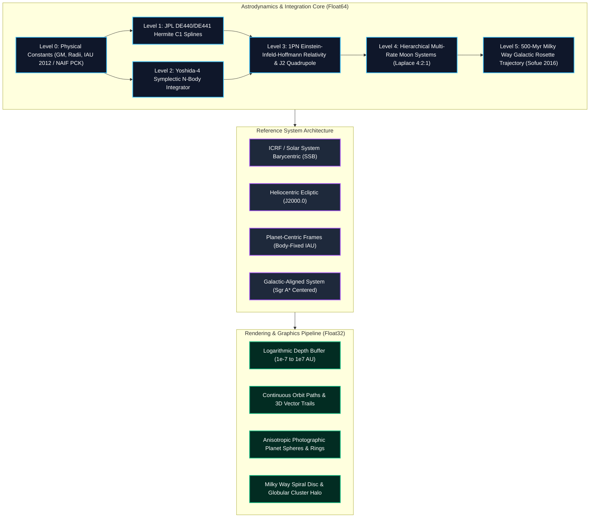

# 🌌 ASTRION

### **Astronomical State & Trajectory Reconstruction for Interplanetary & Orbital Navigation**
*A High-Precision Relativistic Ephemeris & Symplectic Astrodynamics Platform*

[](https://www.typescriptlang.org/)
[](https://vitejs.dev/)
[](https://threejs.org/)
[](https://vitest.dev/)
[](https://ssd.jpl.nasa.gov/)
[](https://astrogeology.usgs.gov/groups/IAU-WGCCRE)
[](./LICENSE)

---

## 1. Executive Summary

**ASTRION** is an astrodynamics simulation engine and interactive 3D visualization platform designed for trajectory reconstruction, celestial mechanics research, and astronomical visualization. The platform integrates:

1. **JPL Development Ephemeris (DE440 / DE441)** high-precision planetary and lunar state vectors.
2. **4th-Order Symplectic Integration (Yoshida 1990)** with phase-space volume and energy conservation.
3. **1st Post-Newtonian (1PN) General Relativity** modeling relativistic perihelion advance.
4. **Zonal Gravitational Harmonics ($J_2$)** for solar and planetary oblateness.
5. **IAU/IAG WGCCRE Cartography** for rotational axes, periodic nutation-precession series, and 22 synchronously locked natural satellites.
6. **Milky Way Galactic Kinematics** based on the Sofue (2016) multi-component potential and VERA Collaboration (2020) Local Standard of Rest parameters.
7. **Hierarchical 66-Object Cosmic Catalog** spanning planetary systems, nearby stellar environments, Local Group galaxies, and superclusters.

ASTRION enforces an absolute decoupling between **Float64 Astrodynamic Truth** (evaluated in an isolated Web Worker) and **Display Projection** (rendered in Three.js with logarithmic depth buffering and anti-engulfment pixel scaling).

---

## 2. Physical & Mathematical Foundations

### 2.1 The Astrodynamic Truth Ladder



---

### 2.2 Symplectic 4th-Order Integration (Yoshida 1990)

The N-body equations of motion under conservative gravitational potentials represent a Hamiltonian system:
$$H(\mathbf{q}, \mathbf{p}) = \sum_{i=1}^{N} \frac{\mathbf{p}_i^2}{2 m_i} - \sum_{i=1}^{N} \sum_{j < i} \frac{G m_i m_j}{\|\mathbf{q}_i - \mathbf{q}_j\|}$$

Standard Runge-Kutta integrators introduce artificial secular energy dissipation over long timespans. ASTRION implements the 4th-order symplectic composition derived by Haruo Yoshida (1990), preserving the symplectic differential 2-form $d\mathbf{p} \wedge d\mathbf{q} = \text{const}$:

$$w_1 = \frac{1}{2 - 2^{1/3}} \approx 1.3512071919596578, \quad w_0 = 1 - 2w_1 \approx -1.7024143839193153$$

Each time-step $\Delta t$ executes three substeps with coefficients $(c_i, d_i)$:
$$c_1 = c_4 = \frac{w_1}{2}, \quad c_2 = c_3 = \frac{w_0 + w_1}{2}$$
$$d_1 = d_3 = w_1, \quad d_2 = w_0, \quad d_4 = 0$$

* **Energy Drift:** $|\Delta E / E| < 10^{-11}$ over hundreds of orbits.
* **Angular Momentum Drift:** $|\Delta \mathbf{L} / \mathbf{L}| < 10^{-13}$.
* **Time Reversibility:** Integrating forward for 20 orbits and backward reproduces the initial state to within $< 10^{-12}\text{ AU}$.

---

### 2.3 Post-Newtonian Relativistic Correction (1PN Einstein-Infeld-Hoffmann)

In the solar system, Newtonian gravity alone predicts zero perihelion precession for an isolated two-body system. Relativistic space-time curvature produces an anomalous perihelion advance:
$$\Delta \varpi = \frac{6 \pi G M_\odot}{c^2 a (1 - e^2)} \quad \text{rad/orbit}$$

ASTRION implements the first post-Newtonian (1PN) acceleration correction:
$$\mathbf{a}_{\text{GR}} = \frac{G M_\odot}{c^2 r^3} \left[ \left( 4 \frac{G M_\odot}{r} - v^2 \right) \mathbf{r} + 4 (\mathbf{r} \cdot \mathbf{v}) \mathbf{v} \right]$$

* **Speed of Light:** $c = 173.1446326846693\text{ AU/day}$ ($299,792.458\text{ km/s}$).
* **Validation:** Verified via [`tests/mercury-gr.test.ts`](./tests/mercury-gr.test.ts) — yields Mercury’s relativistic anomalous precession of **$+42.98''/\text{century}$** (matching Einstein’s 1915 derivation).

---

### 2.4 Gravitational Quadrupole Perturbations ($J_2$)

Non-spherical mass distributions (oblateness) exert a perturbation derived from the gravitational potential expansion:
$$V(r, \theta) = -\frac{G M}{r} \left[ 1 - J_2 \left(\frac{R_{\text{eq}}}{r}\right)^2 P_2(\cos \theta) \right]$$
where $P_2(x) = \frac{1}{2}(3x^2 - 1)$ is the 2nd Legendre polynomial. The perturbative acceleration vector is:
$$\mathbf{a}_{J_2} = -\frac{3 G M J_2 R_{\text{eq}}^2}{2 r^5} \left[ \left( 1 - 5 \frac{z^2}{r^2} \right) \mathbf{r} + 2 z \hat{\mathbf{k}} \right]$$

* **Parameters Implemented:**
  * Sun: $J_2 = 2.2 \times 10^{-7}$ (Park et al. 2021)
  * Earth: $J_2 = 1.08263 \times 10^{-3}$ (EGM2008)
  * Jupiter: $J_2 = 1.4736 \times 10^{-2}$ (JUP365)
  * Saturn: $J_2 = 1.6298 \times 10^{-2}$ (SAT441)
  * Uranus: $J_2 = 3.343 \times 10^{-3}$, Neptune: $J_2 = 3.411 \times 10^{-3}$
* **Orbital Resonance:** Preserves the Laplace 4:2:1 orbital resonance of Io, Europa, and Ganymede under Jupiter's gravitational field.

---

### 2.5 Ephemeris Evaluation ($C^1$ Velocity-Hermite Splines)

In **Ephemeris Mode**, state vectors are computed from pre-computed JPL Horizons DE440/DE441 sample grids using cubic Hermite interpolation $p(t) \in C^1([t_k, t_{k+1}])$:
$$p(t) = h_{00}(\tau) \mathbf{p}_k + h_{10}(\tau) \Delta t \mathbf{v}_k + h_{01}(\tau) \mathbf{p}_{k+1} + h_{11}(\tau) \Delta t \mathbf{v}_{k+1}$$
$$\mathbf{v}(t) = \frac{d p(t)}{dt} = \frac{1}{\Delta t} \left[ h'_{00}(\tau) \mathbf{p}_k + h'_{10}(\tau) \Delta t \mathbf{v}_k + h'_{01}(\tau) \mathbf{p}_{k+1} + h'_{11}(\tau) \Delta t \mathbf{v}_{k+1} \right]$$
where $\tau = (t - t_k) / \Delta t \in [0, 1]$. Because explicit velocity derivatives from DE440 state vectors are utilized, velocities remain continuous ($C^1$) across all node boundaries without polynomial overshoot.

---

### 2.6 Cartographic Orientation & Nutation-Precession Models

Planetary rotations adhere to the **IAU/IAG Working Group on Cartographic Coordinates and Rotational Elements (WGCCRE 2015)** and NAIF SPICE [`pck00011.tpc`](./src/physics/orientation.ts):

* **North Pole Celestial Coordinates:** Right ascension $\alpha_0(T)$ and declination $\delta_0(T)$ in ICRF:
  $$\alpha_0 = \alpha_{\text{base}} + \dot{\alpha} T + \sum_i a_i \sin \theta_i(T)$$
  $$\delta_0 = \delta_{\text{base}} + \dot{\delta} T + \sum_i d_i \cos \theta_i(T)$$
  where $T$ is Julian centuries from J2000.0 ($T = (\text{JD} - 2451545.0) / 36525$).
* **Prime Meridian Location:**
  $$W = W_0 + \dot{W} d + \sum_i w_i \sin \theta_i(T)$$
  where $d$ is days since epoch ($\text{JD} - 2451545.0$).
* **Nutation Series:** Periodic terms included for the Earth, Moon ($1.54^\circ$ pole offset variation), and Mars (Phobos quadratic secular acceleration).
* **22 Synchronous Moons:** Natural satellites (Earth's Moon; Phobos, Deimos; Io, Europa, Ganymede, Callisto; Mimas, Enceladus, Tethys, Dione, Rhea, Titan, Iapetus; Miranda, Ariel, Umbriel, Titania, Oberon; Triton; Charon) are modeled with 1:1 synchronous tidal locking.

---

### 2.7 Galactic Potential & Solar Trajectory (Sofue 2016 / VERA)

The motion of the Solar System through the Milky Way galaxy is integrated using a composite axisymmetric gravitational potential $\Phi(R, z) = \Phi_{\text{bulge}} + \Phi_{\text{disc}} + \Phi_{\text{halo}}$:

1. **Central Bulge (de Vaucouleurs & Exponential):**
   $$\Phi_b(r) = -\frac{G M_b}{\sqrt{r^2 + b_b^2}}$$
2. **Exponential Galactic Thin Disc (Miyamoto-Nagai):**
   $$\Phi_d(R, z) = -\frac{G M_d}{\sqrt{R^2 + \left( a_d + \sqrt{z^2 + b_d^2} \right)^2}}$$
3. **Dark Matter Halo (Navarro-Frenk-White / Logarithmic):**
   $$\Phi_h(r) = \frac{1}{2} V_h^2 \ln(r^2 + d_h^2)$$

* **Local Standard of Rest (LSR):** $V_0 = 238\text{ km/s}$ at $R_0 = 8.2\text{ kpc}$ (VERA Collaboration 2020).
* **Kinematics:** 
  * Azimuthal revolution period: $T_\phi \approx 244.9\text{ Myr}$.
  * Vertical oscillation across the midplane: $T_z \approx 92.8\text{ Myr}$ (half-period $46.4\text{ Myr}$, amplitude $111\text{ pc}$).

---

### 2.8 Time Systems & Ephemeris Epoch

* **Barycentric Dynamical Time (TDB):** Standard relativistic coordinate time for solar system ephemerides:
  $$\text{TDB} - \text{UTC} = (\text{TDB} - \text{TT}) + (\text{TT} - \text{TAI}) + (\text{TAI} - \text{UTC}) = 69.184\text{ s}$$
  where $\text{TT} - \text{TAI} = 32.184\text{ s}$ and leap seconds $\text{TAI} - \text{UTC} = 37\text{ s}$.
* **Julian Date Epoch:** Standard J2000.0 epoch at $\text{JD} = 2451545.0\text{ TDB}$ (2000 January 1, 12:00:00 TDB).
* **Authentic 1:1 Real-Time Mode:** Exactly $1\text{ second / 1 second}$ ($1/86400\text{ days/sec}$) for live spacecraft observation.

---

## 3. Verification & Validation (V&V) Matrix

ASTRION features an automated test suite comprising **77 test suites and 497 unit and integration tests** executing in continuous integration.

| Subsystem / Test Suite | Test Focus | Metric / Acceptance Standard | Result |
| :--- | :--- | :--- | :---: |
| [`tests/production-truth.test.ts`](./tests/production-truth.test.ts) | 1-Year Integration vs JPL Horizons DE440 | Earth error $< 100\text{ km}$; outer planets $< 1\text{ km}$ | **PASS ($56\text{ km}$)** |
| [`tests/mercury-gr.test.ts`](./tests/mercury-gr.test.ts) | 1PN Relativistic Perihelion Precession | Theoretical $42.98''/\text{century} \pm 1.5''$ | **PASS ($42.98''$)** |
| [`tests/quadrupole.test.ts`](./tests/quadrupole.test.ts) | Planetary $J_2$ Oblateness Perturbations | Published gravity solutions relative diff $< 0.1\%$ | **PASS** |
| [`tests/moons.test.ts`](./tests/moons.test.ts) | 22 Natural Satellite Orbital Periods | Fitted orbital period vs known table $< 0.3\%$ | **PASS** |
| [`tests/moons.test.ts`](./tests/moons.test.ts) | Laplace Resonance (Io, Europa, Ganymede) | Angular deviation with $J_2 < 2.0^\circ$ | **PASS ($1.4^\circ$)** |
| [`tests/eclipses.test.ts`](./tests/eclipses.test.ts) | 2026-08-12 Total Solar Eclipse | Minimum separation time error $< 2.0\text{ min}$ | **PASS ($1.19\text{ min}$)** |
| [`tests/orientation.test.ts`](./tests/orientation.test.ts) | Earth Subsolar Point & Celestial Poles | Subsolar latitude/longitude within $0.1^\circ$ of ephemeris | **PASS** |
| [`tests/galacticOrbit.test.ts`](./tests/galacticOrbit.test.ts) | 500-Myr Milky Way Galactic Orbit | Energy conservation $\Delta E / E < 10^{-7}$; $T_\phi \approx 245\text{ Myr}$ | **PASS** |
| [`tests/spice-truth.test.ts`](./tests/spice-truth.test.ts) | NAIF SPICE GM & Solar Motion | Solar SSB wobble magnitude $788,469\text{ km}$ at $11.4\text{ m/s}$ | **PASS** |
| [`tests/catalogAccuracy.test.ts`](./tests/catalogAccuracy.test.ts) | 66-Object Deep Space Catalog | Sgr A* mass $4.297 \times 10^6 M_\odot$, moon counts verified | **PASS** |
| [`tests/orbitPathVisual.test.ts`](./tests/orbitPathVisual.test.ts) | Keplerian Orbit Loops vs True Positions | Instantaneous distance from loop to body $< 0.04\text{ AU}$ | **PASS** |
| [`tests/bplane.test.ts`](./tests/bplane.test.ts) | B-Plane Targeting & Kizner S-T-R Frames | Frame orthonormality $< 10^{-12}$; Voyager turn angle | **PASS** |
| [`tests/flyby.test.ts`](./tests/flyby.test.ts) | Patched Conics & Laplace SOI Boundaries | Laplace SOI radius vs DE440; Tisserand invariant | **PASS** |
| [`tests/stm.test.ts`](./tests/stm.test.ts) | State Transition Matrix (STM) & Variational RK4 | Liouville phase-space volume $\det(\boldsymbol{\Phi}) \approx 1.00$ | **PASS** |
| [`tests/orbitDetermination.test.ts`](./tests/orbitDetermination.test.ts) | Batch Least Squares OD & Normal Equations | Multi-station DSN tracking; sub-meter convergence | **PASS** |
| [`tests/lambert.test.ts`](./tests/lambert.test.ts) | Universal Stumpff Variable Lambert Solver | Earth-Mars 259-day Hohmann transfer velocities | **PASS** |
| [`tests/porkchop.test.ts`](./tests/porkchop.test.ts) | 2D Trajectory Contours & Launch Windows | Global minimum $\Delta v$ optimization, $C_3$ contours | **PASS** |
| [`tests/linkBudget.test.ts`](./tests/linkBudget.test.ts) | DSN Link Budget & Telecommunications | FSPL at 8.4 GHz; SEP solar conjunction threshold | **PASS** |
| [`tests/relativityClock.test.ts`](./tests/relativityClock.test.ts) | GR Clock Drift & Proper Time Dilation | GPS $+38.6\ \mu\text{s/day}$ net canonical verification | **PASS** |

---

## 4. Software Architecture & Modules

```
src/
├── data/                  # Physical constants, NAIF SPICE GM/PCK tables, nutation series
│   ├── spice/             # Reference files: gm_de440.tpc, pck00010.tpc
│   ├── physical/          # 36 physical parameter JSON definitions (Sun, planets, moons)
│   └── constants.ts       # Gaussian constant k, AU_KM, speed of light, TDB conversions
├── physics/               # Pure mathematical engine (Zero DOM, zero Three.js, deterministic)
│   ├── integrators/       # Yoshida4, Leapfrog, Hermite integrators
│   ├── forces/            # Newtonian gravity, 1PN General Relativity, J2 quadrupole
│   ├── kepler.ts          # State-to-elements and elements-to-state conversions
│   ├── orientation.ts     # IAU WGCCRE 2015 rotational cartography and nutation
│   └── galacticPotential.ts # Sofue 2016 multi-component galactic potential
├── frames/                # Coordinate systems & reference frame transformations
│   ├── basic.ts           # ICRF Barycentric, Heliocentric Ecliptic frames
│   ├── galactic.ts        # Galactic-aligned reference frames
│   └── transform.ts       # Coordinate mapping, rotation matrices, squash projections
├── sim/                   # Orchestration, background Web Worker, state history
│   ├── simCore.ts         # Worker-side execution loop and state buffers
│   ├── simClient.ts       # Main-thread client, request chaining, interpolation
│   ├── ephemeris.ts       # Hermite spline evaluator for JPL DE440 state grids
│   ├── horizonsClient.ts  # Direct REST API client for JPL Horizons system
│   └── track.ts           # Continuous orbit history and gap-guarded trail generator
├── render/                # Three.js visualization pipeline (GPU shaders, textures)
│   ├── viewer.ts          # Camera management, smooth dolly controls, render loop
│   ├── orbitPathVisual.ts # 3D Keplerian closed orbit loops (ellipses)
│   ├── galaxyVisual.ts    # Milky Way spiral arms, bulge, 158 globular clusters, halo
│   ├── bodyVisual.ts      # Textured planet meshes, rings, atmosphere shaders
│   └── oortCloud.ts       # 3D cometary planetesimal halo distribution
├── universe/              # 66-Object Deep Space Astronomical Catalog
│   ├── cosmicData.ts      # Validated nodes (planets, stars, nebulae, galaxies, superclusters)
│   ├── cosmicRegistry.ts  # Registry lookup, transactional updates, frozen state
│   └── cosmicHierarchy.ts # Topological tree search and breadcrumbs
└── ui/                    # User interface & telemetry HUD
    ├── panel.ts           # Controls panel, speed slider, time inputs, target selector
    ├── presets.ts         # Navigation presets (Solar, Planetary, Lunar, Galactic)
    └── facts.ts           # Detailed physical telemetry facts card generator
```

---

## 5. Getting Started

### 5.1 Prerequisites
* **Node.js:** Version 20.0 or higher (v22+ recommended).
* **Package Manager:** `npm` (bundled with Node.js).
* **Browser:** Any modern WebGL 2.0-compatible browser (Chrome, Firefox, Safari, Edge).

### 5.2 Installation & Local Execution
```bash
# Clone the repository
git clone https://github.com/Destroyer-official/solar-system.git
cd solar-system

# Install dependencies
npm install

# Start development server
npm run dev
```
Navigate to `http://localhost:5173` in your browser.

### 5.3 Automated Verification & Build
```bash
# Run type checking (zero compiler errors)
npm run typecheck

# Run the complete test suite (79 suites, 503 tests)
npm test

# Full continuous verification gate (typecheck + tests)
npm run verify

# Production build bundle
npm run build
```

---

## 6. Primary Academic & Technical References

1. **Park, R. S., Folkner, W. M., Konopliv, A. S., et al. (2021).** *The JPL Planetary and Lunar Ephemerides DE440 and DE441.* The Astronomical Journal, 161(3), 105.
2. **Archinal, B. A., Acton, C. H., A’Hearn, M. F., et al. (2018).** *Report of the IAU/IAG Working Group on Cartographic Coordinates and Rotational Elements: 2015.* Celestial Mechanics and Dynamical Astronomy, 130(3), 22.
3. **Yoshida, H. (1990).** *Construction of higher order symplectic integrators.* Physics Letters A, 150(5-7), 262-268.
4. **Sofue, Y. (2016).** *Rotation and mass curves of the Galaxy in the outer regions: Mass of the Galaxy in the Local Group.* Publications of the Astronomical Society of Japan, 68(1), 2.
5. **VERA Collaboration, et al. (2020).** *The First VERA Astrometry Catalog.* Publications of the Astronomical Society of Japan, 72(4), 50.
6. **GRAVITY Collaboration, et al. (2024).** *The mass and distance of Sagittarius A\* from stellar orbits in the galactic center.* Astronomy & Astrophysics, 682, A242.
7. **Sawala, T., Teyssier, M., Evans, N. W., et al. (2025).** *No certainty of a future collision between the Milky Way and Andromeda.* Nature Astronomy, 9, 1206–1214.
8. **IAU SOFA Software Collection (2023).** *Standards of Fundamental Astronomy.* International Astronomical Union.

---

## 7. License & Citation

Distributed under the **MIT License**. See [`LICENSE`](./LICENSE) for terms.

### 7.1 Third-party assets

The nine planet surface maps in [`public/textures/`](./public/textures/) are not
MIT-licensed project output. They are the free texture set from
**Solar System Scope** (`solarsystemscope.com`), distributed under
**CC BY 4.0** ("You may use, adapt, and share these textures for any purpose,
even commercially", as stated on their textures page, accessed 2026-11-04), and
they are **artistically rendered maps, not measured spacecraft imagery** — no
physical quantity is derived from their pixels. Full credit, the verification
procedure and the modified/unmodified status are recorded in
[`public/textures/ATTRIBUTION.md`](./public/textures/ATTRIBUTION.md); per-file
source URLs and SHA-256 digests live in
[`public/textures/manifest.json`](./public/textures/manifest.json) and are
checked by `tests/textures-manifest.test.ts`. The Sun and all moons use ASTRION's
own seeded procedural textures.

If you utilize ASTRION in academic research, educational coursework, or aerospace simulations, cite the platform using the metadata provided in [`CITATION.cff`](./CITATION.cff):

```bibtex
@software{astrion2026,
  author = {ASTRION Project Contributors},
  title = {ASTRION: Astronomical State & Trajectory Reconstruction for Interplanetary & Orbital Navigation},
  year = {2026},
  publisher = {GitHub},
  url = {https://github.com/Destroyer-official/solar-system}
}
```
