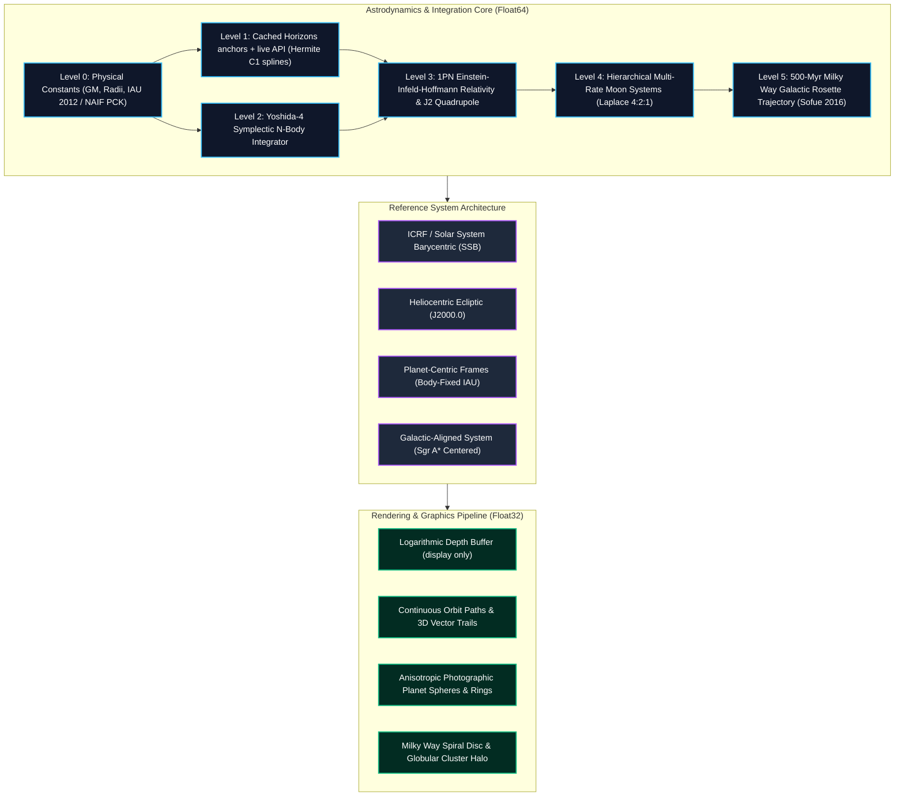

# 🌌 ASTRION

### **Astronomical State & Trajectory Reconstruction for Interplanetary & Orbital Navigation**

_A relativistic orbital-mechanics simulation and 3D visualization platform_

[](https://www.typescriptlang.org/)
[](https://vitejs.dev/)
[](https://threejs.org/)
[](./LICENSE)

ASTRION is an MIT-licensed research/visualization project. **It is not NASA-certified,
not flight-rated, and has not undergone an independent assurance review.** Every
numerical statement in this file is either a test assertion, a command result recorded
in [`docs/VALIDATION_LOG.md`](./docs/VALIDATION_LOG.md), or a primary-source citation
recorded in [`docs/RESEARCH.md`](./docs/RESEARCH.md); everything else is explicitly
labeled unverified (§3). See also
[`docs/NASA_COMPLIANCE.md`](./docs/NASA_COMPLIANCE.md) (Verification Status and Known
Limitations) and [`docs/OPEN_QUESTIONS.md`](./docs/OPEN_QUESTIONS.md).

---

## 1. What the platform does

**ASTRION** is an astrodynamics simulation engine and interactive 3D visualization
platform for trajectory exploration, celestial mechanics study, and astronomical
visualization. What it actually integrates:

1. **Symplectic N-body simulation** (leapfrog, Yoshida 4/6/8) of the Sun, 8 planets,
   22 moons, Pluto/Charon and 4 asteroids in Float64 (AU, day, AU³/day²) inside an
   isolated Web Worker, with optional 1st post-Newtonian (1PN) relativity and
   solar/planetary $J_2$ quadrupole perturbations.
2. **Ephemeris mode** built on **cached JPL Horizons anchor tables** plus a **live
   Horizons API query when reachable** — not a bundled binary DE440/DE441/DE442 SPK
   kernel. GM/radii constants are pinned to the NAIF **DE440** text kernel
   `gm_de440.tpc` (details and honest ephemeris status: §2.5).
3. **IAU/IAG WGCCRE 2015 (as corrected 2019)** cartographic orientation models for
   rotational poles, meridian rotation and synchronously locked satellites.
4. **Milky Way motion** through a Miyamoto–Nagai + logarithmic-halo galactic potential
   with named LSR models in `src/data/galaxy.ts` (selector limitation: §2.7).
5. **Hierarchical multi-rate moon systems** (barycenter level-0, sub-cycled planet-moon
   level-1) with the Laplace-resonance behaviour asserted in `tests/moons.test.ts`.
6. **66-node deep-space catalog** (`src/universe/cosmicData.ts`;
   `tests/catalogAccuracy.test.ts` asserts ≥50 nodes and pins selected facts to
   cited measurements).
7. An absolute decoupling between **Float64 astrodynamic truth** (Web Worker) and
   **display projection** (Three.js: logarithmic depth buffering, exaggerated body
   radii, view-only squash projections). Rendering is display, never physics.

Run counts and coverage for the current tree are in §2.1 and §3; §4 explains which
integrators are actually selectable at runtime (IAS15 exists but is not one of them).

---

## 2. Physical & Mathematical Foundations

### 2.1 Measured runs and test status

- **2026-11-05 local run: 84 files / 544 tests; GitHub Actions status is not claimed here.**
  In the same local context `npm run typecheck`, `npm run lint` and `npm run build` each
  exited 0 (full transcripts, including the step 3c run recorded at 83 files / 539 tests,
  are in [`docs/VALIDATION_LOG.md`](./docs/VALIDATION_LOG.md)).
- **Coverage (measured 2026-11-05 at step 3c, during the 539-test run — not re-run since):**
  all sources 63.41 % lines; `src/physics` 93.25 % lines / 69.69 % branches;
  `src/frames` 100 % lines/branches; coverage thresholds are **not enabled**.
- No CI run, Playwright audit, or binary-SPK-vs-CSPICE position comparison has been
  performed; anything requiring them is listed as unverified in §3.

The layered design at a glance (truth ladder):



---

### 2.2 Symplectic integration (Yoshida 1990)

The N-body equations of motion under conservative gravitational potentials represent a Hamiltonian system:
$$H(\mathbf{q}, \mathbf{p}) = \sum_{i=1}^{N} \frac{\mathbf{p}_i^2}{2 m_i} - \sum_{i=1}^{N} \sum_{j < i} \frac{G m_i m_j}{\|\mathbf{q}_i - \mathbf{q}_j\|}$$

Standard Runge-Kutta integrators introduce artificial secular energy dissipation over long timespans. ASTRION's runtime integrators compose the leapfrog (drift–kick–drift) map with Yoshida's higher-order symmetric weights (Yoshida 1990), preserving the symplectic structure by construction:

$$w_1 = \frac{1}{2 - 2^{1/3}} \approx 1.3512071919596578, \quad w_0 = 1 - 2w_1 \approx -1.7024143839193153$$

Each time-step $\Delta t$ executes substeps with coefficients $(c_i, d_i)$:
$$c_1 = c_4 = \frac{w_1}{2}, \quad c_2 = c_3 = \frac{w_0 + w_1}{2}$$
$$d_1 = d_3 = w_1, \quad d_2 = w_0, \quad d_4 = 0$$

What the tests actually assert (`tests/yoshida4.test.ts`) — not open-ended accuracy claims:

- **Convergence order:** halving the step cuts the energy error by a factor between 13 and 19 (~$2^4$).
- **Time reversibility:** forward + backward integration returns each coordinate to within $10^{-12}$ AU.
- **Energy drift:** over 10 Jupiter orbits the worst relative drift is asserted $< 10^{-9}$
  (the "~1e-10" in the test title is console output, not a retained measurement).

Symplectic integrators keep energy error _bounded_ over long spans; no absolute
per-mission drift figure is claimed here.

---

### 2.3 Post-Newtonian Relativistic Correction (1PN Einstein-Infeld-Hoffmann)

In the solar system, Newtonian gravity alone predicts zero perihelion precession for an isolated two-body system. Relativistic space-time curvature produces an anomalous perihelion advance:
$$\Delta \varpi = \frac{6 \pi G M_\odot}{c^2 a (1 - e^2)} \quad \text{rad/orbit}$$

ASTRION implements the first post-Newtonian (1PN) acceleration correction:
$$\mathbf{a}_{\text{GR}} = \frac{G M_\odot}{c^2 r^3} \left[ \left( 4 \frac{G M_\odot}{r} - v^2 \right) \mathbf{r} + 4 (\mathbf{r} \cdot \mathbf{v}) \mathbf{v} \right]$$

- **Speed of Light:** not a hard-coded literal — `src/data/constants.ts` derives
  $c = \frac{299\,792.458 \times 86\,400}{149\,597\,870.7} \approx 173.14463267\text{ AU/day}$
  from the exact SI-defined $c = 299\,792.458\text{ km/s}$ and the IAU 2012 exact AU
  $= 149\,597\,870.7$ km. (The previously printed value 173.1446326846693 did not
  match the code; see VALIDATION_LOG "Unverified claims".)
- **Validation:** [`tests/mercury-gr.test.ts`](./tests/mercury-gr.test.ts) asserts the
  measured anomalous precession lies in the window **41.5–44.5 arcsec/century** (and a
  Newton-only control asserts no precession); [`tests/eih.test.ts`](./tests/eih.test.ts)
  asserts the same window for the multi-body EIH formulation. The canonical Einstein
  value $42.98''/\text{century}$ is the literature target, not a recorded measurement of
  this code.

---

### 2.4 Gravitational Quadrupole Perturbations ($J_2$)

Non-spherical mass distributions (oblateness) exert a perturbation derived from the gravitational potential expansion:
$$V(r, \theta) = -\frac{G M}{r} \left[ 1 - J_2 \left(\frac{R_{\text{eq}}}{r}\right)^2 P_2(\cos \theta) \right]$$
where $P_2(x) = \frac{1}{2}(3x^2 - 1)$ is the 2nd Legendre polynomial. The perturbative acceleration vector is:
$$\mathbf{a}_{J_2} = -\frac{3 G M J_2 R_{\text{eq}}^2}{2 r^5} \left[ \left( 1 - 5 \frac{z^2}{r^2} \right) \mathbf{r} + 2 z \hat{\mathbf{k}} \right]$$

- **Parameters shipped** in `src/data/physical/*.json` and `src/data/constants.ts`:
  - Sun: $J_2 = 2.2 \times 10^{-7}$ (Park et al. 2021, DE440; `src/data/constants.ts`)
  - Earth: $J_2 = 1.08263 \times 10^{-3}$
  - Jupiter: $J_2 = 1.4736 \times 10^{-2}$
  - Saturn: $J_2 = 1.6298 \times 10^{-2}$
  - Uranus: $J_2 = 3.343 \times 10^{-3}$, Neptune: $J_2 = 3.411 \times 10^{-3}$
- **Validation:** `tests/quadrupole.test.ts` asserts each configured $J_2$ matches its published value within 0.1 % relative and that the reciprocal solar reaction conserves total momentum (residual checked at the $\sim 10^{-14}$ level). The Io–Europa–Ganymede Laplace resonance over 20 yr is asserted in `tests/moons.test.ts` (max deviation $< 2.0^\circ$ with Jupiter $J_2$, and strictly larger without it); exact measured deviations appear only in console output and are not retained claims.

---

### 2.5 Ephemeris Evaluation ($C^1$ Velocity-Hermite Splines)

In **Ephemeris Mode**, state vectors come from **cached JPL Horizons anchor tables** (`src/data/horizons-reference.json`, `src/data/dense-reference.json`, refreshed via `npm run fetch:horizons`), interpolated with cubic Hermite $p(t) \in C^1([t_k, t_{k+1}])$ in `src/sim/ephemeris.ts`:
$$p(t) = h_{00}(\tau) \mathbf{p}_k + h_{10}(\tau) \Delta t \mathbf{v}_k + h_{01}(\tau) \mathbf{p}_{k+1} + h_{11}(\tau) \Delta t \mathbf{v}_{k+1}$$
$$\mathbf{v}(t) = \frac{d p(t)}{dt} = \frac{1}{\Delta t} \left[ h'_{00}(\tau) \mathbf{p}_k + h'_{10}(\tau) \Delta t \mathbf{v}_k + h'_{01}(\tau) \mathbf{p}_{k+1} + h'_{11}(\tau) \Delta t \mathbf{v}_{k+1} \right]$$
where $\tau = (t - t_k) / \Delta t \in [0, 1]$. Because the dense anchors carry explicit Horizons velocities, interpolated velocities remain continuous ($C^1$) at node boundaries; sparse position-only anchors fall back to a blended position interpolation. `reseedLive` queries the Horizons REST API when reachable, appending fresh anchors, or falls back to the cached tables when not (`src/sim/horizonsClient.ts`).

**How far that is trustworthy:** the dense table spans jd 2460954.5–2462049.5, i.e. −1 to +2 years around the cached epoch (1.5-day nodes for the inner planets and the Moon, 9-day for the Sun and outer planets), and the sparse table then supplies only ±365.25, ±3652.5 and +18262.5 days. Measured against `de440.bsp` (`docs/VALIDATION_LOG.md` step 7), interpolation error is ≤ 1.0 km for the Sun and every planet but Mercury (1.014e+2 km) over ±300 days, rises to 2.6e+5–5.4e+6 km at the +365.25 d anchor and at the dense-window edge, and reaches 1.1e+8–2.8e+9 km (0.8–18.6 AU) wherever only the corner anchors bracket the date. The evaluator clamps outside its table window. Widening the anchored span, gating the UI to the dense window, or driving this mode from the kernel reader is tracked as AUDIT-51 / OPEN-008.

**What this is not:** the repo bundles **no binary DE440/DE441/DE442 `.bsp` SPK kernel** and performs no CSPICE position comparison. A read-only DAF/SPK type 2/3 parser does exist (`src/sim/spk.ts`) and is validated by `npm run verify:spk`, which downloads `de440.bsp` into the gitignored `tests/validation/.cache/`, requires NAIF's published MD5, and reproduces nine cached Horizons vectors to 2.4e-4 m and 7.1e-8 mm/s (`docs/VALIDATION_LOG.md` step 6) — but **no runtime module evaluates a kernel**, so the positions the app integrates stay Hermite interpolations of cached vectors. The only DE440 artefacts that ship are the NAIF **text** kernels `gm_de440.tpc`, `pck00010.tpc`, `pck00011.tpc` in `src/data/spice/` (GM/radii/orientation constants, SHA-256-pinned locally in `provenance.json` and checked by `tests/spice-truth.test.ts`; NAIF itself publishes only MD5 — `docs/RESEARCH.md` §6). Per `docs/RESEARCH.md` §1 (accessed 2026-11-04): DE440 is the modern whole-system solution (Park et al. 2021); **DE441** is the long-span historical solution (c. −13201 to +17191), **not** the newest ephemeris; **DE442** (2025-02-06) is the newest general-purpose kernel, an update of DE440 driven mainly by the Uranus barycentre. Any claim that this app "uses DE441" or evaluates a DE kernel directly is false and has been removed.

---

### 2.6 Cartographic Orientation & Nutation-Precession Models

Planetary rotations adhere to the **IAU/IAG Working Group on Cartographic Coordinates and Rotational Elements (WGCCRE 2015 report, Archinal et al. 2018, as corrected 2019)**; the machine-readable constants are `pck00010.tpc` / `pck00011.tpc` in [`src/data/spice/`](./src/data/spice/), consumed by [`src/physics/orientation.ts`](./src/physics/orientation.ts):

- **North Pole Celestial Coordinates:** Right ascension $\alpha_0(T)$ and declination $\delta_0(T)$ in ICRF:
  $$\alpha_0 = \alpha_{\text{base}} + \dot{\alpha} T + \sum_i a_i \sin \theta_i(T)$$
  $$\delta_0 = \delta_{\text{base}} + \dot{\delta} T + \sum_i d_i \cos \theta_i(T)$$
  where $T$ is Julian centuries from J2000.0 ($T = (\text{JD} - 2451545.0) / 36525$).
- **Prime Meridian Location:**
  $$W = W_0 + \dot{W} d + \sum_i w_i \sin \theta_i(T)$$
  where $d$ is days since epoch ($\text{JD} - 2451545.0$).
- **Nutation Series:** Periodic terms included for the Earth and for satellite longitude/libration terms (e.g. Phobos quadratic secular acceleration), per the 2015 report and its 2019 correction. Caution (AUDIT-28): the `1.54` value in `src/data/rotational.ts` for the Moon is its **axial tilt**, not a nutation amplitude — earlier text here conflated the two.
- **22 Synchronous Moons:** 22 moon parameter files ship in [`src/data/moons/`](./src/data/moons/); synchronous (1:1 tidal-lock) orientation conventions are implemented in `src/physics/orientation.ts` and exercised by `tests/orientation.test.ts` and `tests/moons.test.ts`.

---

### 2.7 Galactic Potential & Solar Trajectory

The motion of the Solar System through the Milky Way is integrated in
`src/physics/galacticPotential.ts` with a composite axisymmetric potential
$\Phi(R, z) = \Phi_{\text{bulge}} + \Phi_{\text{disc}} + \Phi_{\text{halo}}$:

1. **Bulge (Miyamoto–Nagai):**
   $$\Phi_b(R, z) = -\frac{G M_b}{\sqrt{R^2 + \left( a_b + \sqrt{z^2 + b_b^2} \right)^2}}$$
2. **Disc (Miyamoto–Nagai):**
   $$\Phi_d(R, z) = -\frac{G M_d}{\sqrt{R^2 + \left( a_d + \sqrt{z^2 + b_d^2} \right)^2}}$$
3. **Dark-matter halo (calibrated logarithmic):**
   $$\Phi_h(r) = \frac{1}{2} V_h^2 \ln(r^2 + d_h^2)$$

- **Local Standard of Rest:** the runtime default is the `iau1985` model —
  $V_0 = 220\text{ km/s}$ at $R_0 = 8.2\text{ kpc}$ (`src/data/galaxy.ts`,
  `DEFAULT_GALAXY_MODEL = GALAXY_MODELS[0]`; `galacticPotential.ts` uses
  `LSR_SPEED_KMS = 220`). `src/data/galaxy.ts` also catalogues `sofue2016` (238 km/s at
  8.0 kpc), `reid2019` (236 km/s at 8.15 kpc) and `gravity2021` (240 km/s at 8.275 kpc)
  with their citations.
- **Known limitation (AUDIT-26 in `docs/AUDIT.md`):** every model entry is marked
  `implementation: 'lsrR0Only'` — selecting a model changes only the LSR speed and $R_0$
  passed to the potential; the potential's mass distribution does not become
  model-specific. Sofue-style NFW haloes and per-model bulge/disc structures described
  in the literature are **not** switched in.
- **Kinematics:** no single "measured" period is retained. `tests/galacticOrbit.test.ts`
  asserts the circular period at (220 km/s, 8.2 kpc) is 220–235 Myr, the integrated solar
  azimuthal period is 200–250 Myr, the vertical oscillation period is 60–95 Myr with
  amplitude 60–140 pc, energy drift $< 10^{-5}$ and $L_z$ drift $< 10^{-12}$ over 500 Myr,
  and straight-vs-curved departure $< 0.01\text{ AU}$ over 100 yr. Exact values printed by
  those tests are console output only, not recorded measurements.

---

### 2.8 Time Systems & Ephemeris Epoch

- **Time scales:** $\text{TT} - \text{TAI} = 32.184\text{ s}$ exactly; the last leap second was inserted **2017-01-01**, giving $\text{TAI} - \text{UTC} = 37\text{ s}$, hence $\text{TT} - \text{UTC} = 69.184\text{ s}$. `src/data/constants.ts` uses this as the TDB↔UTC offset (`TDB_MINUS_UTC_S = 69.184`), ignoring the TDB − TT periodic term (< ±1.7 ms). `tests/time.test.ts` asserts the historical leap-second table (10 s in 1972, 32 s at J2000, 37 s in 2026), TT − UTC ≈ 69.184 s, and TDB − TT within ±1.75 ms (Fairhead & Bretagnon 1990 series).
- **Currency:** per `docs/RESEARCH.md` §2, IERS **Bulletin C 72** (accessed 2026-11-04) confirmed no leap second through end-2026 and `naif0012.tls` is documented valid at least to 2027-07-01. Whether a newer bulletin has since changed the table is tracked as OPEN-004 in `docs/OPEN_QUESTIONS.md` — the value must be re-verified, not assumed.
- **Julian Date Epoch:** standard J2000.0 at $\text{JD} = 2451545.0$ (2000 January 1, 12:00:00 TT; defined as TT per RESEARCH §3, used as the TDB-based computational epoch).
- **1:1 Real-Time Mode:** simulation advances at $1/86400\text{ days/s}$ (one sim second per wall second) when selected in the UI.

---

## 3. What is measured vs what remains unverified

The suite (2026-11-05 local run: **84 files / 544 tests**; no CI claim) enforces the
assertions below. "Assertion" means the bound hard-coded in the test; it is _not_ a
measured error figure, and no tighter value is retained anywhere.

### Measured / asserted

| Test                                                                                                 | What it asserts (exact bound in the test)                                                                                                                                                   | Evidence                                         |
| :--------------------------------------------------------------------------------------------------- | :------------------------------------------------------------------------------------------------------------------------------------------------------------------------------------------ | :----------------------------------------------- |
| [`tests/production-truth.test.ts`](./tests/production-truth.test.ts)                                 | 1-yr production integration (Yoshida-4 + 1PN + solar $J_2$, hierarchical, vs cached Horizons fixture): every system barycenter within $10^{-3}\text{ AU}$ (≈149,600 km)                     | assertion at `:82`                               |
| [`tests/horizons-phase3.test.ts`](./tests/horizons-phase3.test.ts)                                   | Mercury barycenter error at +10 yr $< 1.5\times10^{-3}\text{ AU}$ vs cached Horizons sample                                                                                                 | assertion at `:49`                               |
| [`tests/mercury-gr.test.ts`](./tests/mercury-gr.test.ts), [`tests/eih.test.ts`](./tests/eih.test.ts) | 1PN / EIH Mercury anomalous precession in 41.5–44.5 arcsec/century; Newton-only control < $10^{-5}$ rad                                                                                     | assertions at `mercury-gr:43,72-73`, `eih:55-56` |
| [`tests/quadrupole.test.ts`](./tests/quadrupole.test.ts)                                             | configured $J_2$ values within 0.1 % of published; momentum reaction residual via `toBeCloseTo(0, 14)`; perturbation sign checks                                                            | `:23,69-70`                                      |
| [`tests/moons.test.ts`](./tests/moons.test.ts)                                                       | 16 table-tested orbital periods within 0.3 %; semi-major axes within 1 % of JPL mean elements; Laplace resonance deviation < $2.0^\circ$ with $J_2$ and strictly larger without             | `:150,155-258,326-327`                           |
| [`tests/eclipses.test.ts`](./tests/eclipses.test.ts)                                                 | 2026-08-12 eclipse assertion: min separation 0.70°–1.00°, timing error < 20 minutes; `5775d66` run printed 0.891° and 1.19 min (VALIDATION_LOG step 5)                                      | `:110-114` + retained run                        |
| [`tests/spice-truth.test.ts`](./tests/spice-truth.test.ts)                                           | kernel text files match recorded SHA-256/byte-count; body GMs match `gm_de440.tpc` at 1e-12; Sun genuinely moves in SSB frame ($r > 10^{-4}$ AU, $v > 10^{-6}$ AU/day); SSB residual bounds | `:56-110`                                        |
| [`tests/time.test.ts`](./tests/time.test.ts)                                                         | leap-second table (10/32/37 s), TT−TAI = 32.184 s, TT−UTC ≈ 69.184 s, TDB−TT within ±1.75 ms, periodic inverse, and UTC↔TDB date round-trips                                                | `:26-136`                                        |
| [`tests/galacticOrbit.test.ts`](./tests/galacticOrbit.test.ts)                                       | circular period 220–235 Myr; azimuthal 200–250 Myr; vertical 60–95 Myr, amplitude 60–140 pc; $                                                                                              | \Delta E/E                                       | < 10^{-5}$, $L_z$ drift $< 10^{-12}$ over 500 Myr; straight-vs-curved < 0.01 AU/100 yr | `:5-126` |
| [`tests/frames.test.ts`](./tests/frames.test.ts)                                                     | solar speed in CMB frame: $\|v\| - 369.82\| < 0.05$ km/s (Planck 2020 dipole value)                                                                                                         | `:143-150`                                       |
| [`tests/orientation.test.ts`](./tests/orientation.test.ts)                                           | Earth subsolar point at 2026-10-06 12:00 UTC: lat in (−5.5, −4.9)°, lon in (−3.9, −1.9)°; rotation-matrix orthonormality; sidereal-tilt checks                                              | `:112-144`                                       |
| [`tests/pck-rotation.test.ts`](./tests/pck-rotation.test.ts)                                         | pole, spin, quadratic and nutation series for every catalogued rotation match the SHA-256-verified `pck00011.tpc` snapshot at declared tolerances                                           | `:82-150`                                        |
| [`tests/orientation-property.test.ts`](./tests/orientation-property.test.ts)                         | seeded 1,000-case ±50-year check: every rotation matrix is orthonormal/right-handed, and body↔ecliptic vector conversion round-trips                                                        | `:34-77`                                         |
| [`tests/yoshida4.test.ts`](./tests/yoshida4.test.ts)                                                 | 4th-order convergence (error ratio 13–19 per halving), reversibility to $10^{-12}$ AU, 10-Jupiter-orbit drift $<10^{-9}$                                                                    | `:31-59`                                         |
| [`tests/ias15.test.ts`](./tests/ias15.test.ts)                                                       | module-level only (not runtime-selectable, §4): 1-yr circular-orbit drift $<10^{-8}$, $e=0.8$ periapsis handled, reversibility to 7 decimals                                                | `:30-85`                                         |
| [`tests/textures-manifest.test.ts`](./tests/textures-manifest.test.ts) + VALIDATION_LOG 2026-11-04   | all 9 texture files match manifest SHA-256 and byte length; independent Python re-hash 9/9; provider license confirmed CC BY 4.0                                                            | asset-verify entry in `docs/VALIDATION_LOG.md`   |

### Unverified — do not cite as results

- **Any general km-level positional accuracy vs JPL.** The old "PASS (56 km)" and
  "solar wobble 788,469 km at 11.4 m/s" figures had no retained assertion or recorded
  run and remain removed (VALIDATION_LOG "Unverified claims"; AUDIT-19/21). The eclipse
  1.19-minute result from the `5775d66` step-5 run is retained as one observed value;
  the previous contradictory 1.19/2.35-minute prose is not a permanent assertion.
- **Per-body +10/+50 yr error tables** (ephemeris.ts computes a runtime validation
  table, but no per-body figures are recorded as measurements).
- **CI status.** `.github/workflows/ci.yml` exists; no GitHub Actions run is claimed
  here (AUDIT context in `docs/AUDIT.md`).
- **Coverage thresholds** are not enabled; the 63.41 % / 93.25 % / 100 % figures are
  step-3c baselines, not gates.
- **Invariant thresholds** (energy / angular-momentum / barycenter drift at 1e-6 in
  `src/observability/invariants.ts`) are operational defaults explicitly marked
  UNVERIFIED (OPEN-001 in `docs/OPEN_QUESTIONS.md`); they are not NASA/IAU/JPL targets.
- **Runtime IAS15** — see §4: implemented and unit-tested, not wired into the worker.
- **Render counts** such as 158 globular clusters are procedural defaults in
  `src/render/galaxyVisual.ts:226`, not catalogue-derived values (no Harris catalogue
  ships in the repo).
- **E2E / browser behavior** — Playwright scripts exist but are manual; nothing gates them.
- **Textures are third-party CC BY 4.0 artistically rendered maps, not spacecraft
  measurements**; no physical quantity is sampled from their pixels (§8.1).

---

## 4. Integrators: what is actually selectable at runtime

The worker protocol accepts exactly these integrator names
(`src/sim/protocol.ts:18`, `src/sim/config.ts:2`):
**`leapfrog`, `yoshida4`, `yoshida6`, `yoshida8`, `truth8`**.
`buildIntegrator` (`src/sim/simCore.ts:15-20`) implements them as leapfrog and Yoshida
symplectic compositions; `yoshida8` and `truth8` resolve to the same Yoshida-8
composition. The library default is `yoshida6` (`src/sim/config.ts:14`), while the
shipped browser app initializes `yoshida4` at 0.2-day fixed steps (`src/main.ts:83`).

Additionally, but **implemented and unit-tested only — not wired into the runtime**:

- `src/physics/integrators/ias15.ts` — a native Gauss–Radau implementation after
  Rein & Spiegel (2015), passing `tests/ias15.test.ts` (energy drift < 1e-8 on a 1-yr
  circular orbit, adaptive passage of an $e=0.8$ periapsis, forward/backward
  reversibility), but **no runtime module imports it and it cannot be selected**.
  Wiring it in is open work (`docs/RESEARCH.md` §7.6).
- `src/physics/integrators/rk89.ts` — despite the file name, it implements
  `TruthIntegrator8`, a fixed-sub-step wrapper around the Yoshida-8 composition; it
  contains **no Dormand–Prince RK8(9) coefficients** and is not runtime-selectable
  (unit-tested in `tests/rk89.test.ts`).
- `src/physics/integrators/compensated.ts` — Kahan-compensated leapfrog, unit-tested,
  not runtime-selectable.

---

## 5. Software Architecture & Modules

```
src/
├── data/                  # Physical constants, NAIF SPICE GM/PCK tables, nutation series
│   ├── spice/             # NAIF text kernels: gm_de440.tpc, pck00010.tpc, pck00011.tpc + provenance.json
│   ├── physical/          # 36 physical parameter JSON definitions (Sun, planets, moons)
│   └── constants.ts       # Gaussian constant k, AU_KM, speed of light, TDB conversions
├── physics/               # Pure mathematical engine (Zero DOM, zero Three.js, deterministic)
│   ├── integrators/       # leapfrog, yoshida4/6/8 (runtime); ias15/compensated/rk89 unit-tested only
│   ├── forces/            # Newtonian gravity, 1PN General Relativity, J2 quadrupole
│   ├── kepler.ts          # State-to-elements and elements-to-state conversions
│   ├── orientation.ts     # IAU WGCCRE 2015 rotational cartography and nutation
│   └── galacticPotential.ts # Miyamoto–Nagai bulge/disc + calibrated logarithmic halo
├── frames/                # Coordinate systems & reference frame transformations
│   ├── basic.ts           # ICRF Barycentric, Heliocentric Ecliptic frames
│   ├── galactic.ts        # Galactic-aligned reference frames
│   └── transform.ts       # Coordinate mapping, rotation matrices, squash projections
├── sim/                   # Orchestration, background Web Worker, state history
│   ├── simCore.ts         # Worker-side execution loop and state buffers
│   ├── simClient.ts       # Main-thread client, request chaining, interpolation
│   ├── ephemeris.ts       # Hermite evaluator over cached Horizons anchors (+ live reseed)
│   ├── horizonsClient.ts  # Direct REST API client for JPL Horizons system
│   ├── track.ts           # Continuous orbit history and gap-guarded trail generator
│   └── facts.ts           # Detailed physical telemetry facts card generator
├── render/                # Three.js visualization pipeline (GPU shaders, textures)
│   ├── viewer.ts          # Camera management, smooth dolly controls, render loop
│   ├── orbitPathVisual.ts # 3D Keplerian closed orbit loops (ellipses)
│   ├── galaxyVisual.ts    # Milky Way spiral arms, bulge, halo (158 cluster points are a procedural default)
│   ├── bodyVisual.ts      # Textured planet meshes, rings, atmosphere shaders
│   └── oortCloud.ts       # 3D cometary planetesimal halo distribution
├── universe/              # 66-Object Deep Space Astronomical Catalog
│   ├── cosmicData.ts      # Validated nodes (planets, stars, nebulae, galaxies, superclusters)
│   ├── cosmicRegistry.ts  # Registry lookup, transactional updates, frozen state
│   └── cosmicHierarchy.ts # Topological tree search and breadcrumbs
└── ui/                    # User interface & telemetry HUD
    ├── panel.ts           # Controls panel, speed slider, time inputs, target selector
    └── presets.ts         # Navigation presets (Solar, Planetary, Lunar, Galactic)
```

---

## 6. Getting Started

### 6.1 Prerequisites

- **Node.js:** Version 20.0 or higher (v22+ recommended).
- **Package Manager:** `npm` (bundled with Node.js).
- **Browser:** Any modern WebGL 2.0-compatible browser (Chrome, Firefox, Safari, Edge).

### 6.2 Installation & Local Execution

```bash
# Clone the repository
git clone https://github.com/Destroyer-official/solar-system.git
cd solar-system

# Install dependencies
npm install

# Start development server
npm run dev
```

Navigate to `http://localhost:5173` in your browser.

### 6.3 Verification & Build (local only)

```bash
npm run typecheck        # tsc --noEmit (strict, noUncheckedIndexedAccess, erasableSyntaxOnly)
npm run lint             # ESLint over src, tests, vite.config.ts
npm test                 # vitest run (2026-11-05 local run: 84 files / 544 tests)
npm run test:coverage    # vitest --coverage (instrumented; slow, ~150 s)
npm run verify           # typecheck + lint + test
npm run verify:prod      # typecheck + lint + test + production build
npm run build            # tsc --noEmit && vite build
```

No GitHub Actions run of these commands is claimed here; the transcripts that exist are
local (all produced on the Windows machine documented in `docs/VALIDATION_LOG.md`).

---

## 7. Primary Academic & Technical References

1. **Park, R. S., Folkner, W. M., Konopliv, A. S., et al. (2021).** _The JPL Planetary and Lunar Ephemerides DE440 and DE441._ The Astronomical Journal, 161(3), 105. — source of the `gm_de440.tpc` constants used here.
2. **Archinal, B. A., Acton, C. H., A'Hearn, M. F., et al. (2018).** _Report of the IAU/IAG Working Group on Cartographic Coordinates and Rotational Elements: 2015._ Celestial Mechanics and Dynamical Astronomy, 130(3), 22. (+2019 correction, CMDA 131:61 — per `docs/RESEARCH.md` §3.)
3. **Yoshida, H. (1990).** _Construction of higher order symplectic integrators._ Physics Letters A, 150(5-7), 262-268.
4. **Rein, H. & Spiegel, D. S. (2015).** _IAS15: A fast, adaptive, high-order integrator for gravitational dynamics, accurate to machine precision over a billion orbits._ MNRAS 446(2), 1424–1437. — implemented in `src/physics/integrators/ias15.ts` (unit-tested, not runtime-selectable; §4).
5. **Sofue, Y. (2016).** _Rotation and mass curves of the Galaxy in the outer regions: Mass of the Galaxy in the Local Group._ Publications of the Astronomical Society of Japan, 68(1), 2.
6. **VERA Collaboration, et al. (2020).** _The First VERA Astrometry Catalog._ Publications of the Astronomical Society of Japan, 72(4), 50.
7. **Reid et al. (2019).** ApJ 885:131; **GRAVITY Collaboration (2021).** A&A 647:A59; **GRAVITY Collaboration, et al. (2024).** _The mass and distance of Sagittarius A\* from stellar orbits in the galactic center._ Astronomy & Astrophysics, 682, A242 — galactic parameters catalogued in `src/data/galaxy.ts`.
8. **Planck Collaboration (2020).** A&A 641:A1 — CMB dipole (369.82 km/s, l = 264.021°, b = 48.253°).
9. **Charlot et al. (2020).** A&A 644:A159 — ICRF3 frame definition.
10. **Fairhead, P. & Bretagnon, P. (1990).** A&A 229:240 — analytical TDB − TT series.
11. **IERS Bulletin C 72** (accessed 2026-11-04) and `Leap_Second.dat` (last row 2017-01-01, TAI − UTC = 37 s) — leap-second status and update procedure: `docs/RESEARCH.md` §2.
12. **Sawala, T., Teyssier, M., Evans, N. W., et al. (2025).** _No certainty of a future collision between the Milky Way and Andromeda._ Nature Astronomy, 9, 1206–1214.
13. **IAU SOFA Software Collection (2023).** _Standards of Fundamental Astronomy._ International Astronomical Union.

---

## 8. License & Citation

Distributed under the **MIT License** — `AS IS`, without warranty of any kind. See
[`LICENSE`](./LICENSE) for terms. This project is **not** NASA-certified, not
flight-rated, and has had no independent assurance review; nothing in this repository
should be read as approval for operational use.

### 8.1 Third-party assets

The nine planet surface maps in [`public/textures/`](./public/textures/) are not
MIT-licensed project output. They are the free texture set from
**Solar System Scope** (`solarsystemscope.com`), distributed under
**CC BY 4.0** ("You may use, adapt, and share these textures for any purpose,
even commercially", as stated on their textures page, accessed 2026-11-04), and
they are **artistically rendered maps, not measured spacecraft imagery** — no
physical quantity is derived from their pixels. Full credit, the verification
procedure and the modified/unmodified status are recorded in
[`public/textures/ATTRIBUTION.md`](./public/textures/ATTRIBUTION.md); per-file
source URLs and SHA-256 digests live in
[`public/textures/manifest.json`](./public/textures/manifest.json) and are
checked by `tests/textures-manifest.test.ts`. The Sun and all moons use ASTRION's
own seeded procedural textures.

If you utilize ASTRION in academic research, educational coursework, or aerospace simulations, cite the platform using the metadata provided in [`CITATION.cff`](./CITATION.cff):

```bibtex
@software{astrion2026,
  author = {ASTRION Project Contributors},
  title = {ASTRION: Astronomical State & Trajectory Reconstruction for Interplanetary & Orbital Navigation},
  year = {2026},
  publisher = {GitHub},
  url = {https://github.com/Destroyer-official/solar-system}
}
```
